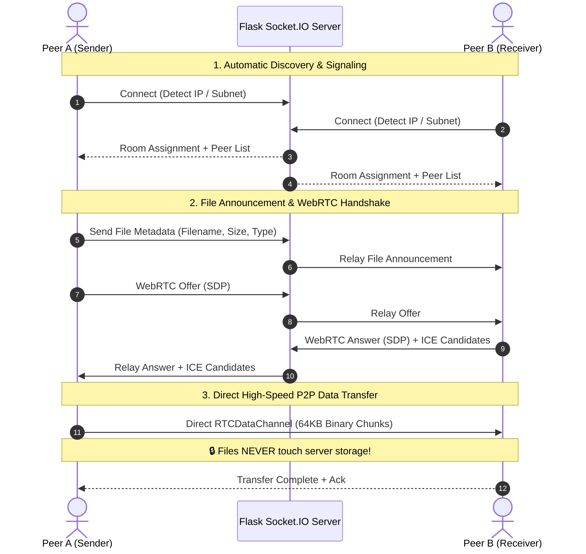

<div align="center">

# ⚡ Onnet — Office Network Drop & Intercom

**Zero-install, zero-account, peer-to-peer file transfer and instant text intercom for local office networks.**

[](https://opensource.org/licenses/MIT)
[](https://www.python.org/)
[](https://react.dev/)
[](https://vitejs.dev/)
[](https://webrtc.org/)
[](https://socket.io/)
[](https://tailwindcss.com/)

<p align="center">
  <a href="#-overview">Overview</a> •
  <a href="#-key-features">Key Features</a> •
  <a href="#-architecture--how-it-works">Architecture</a> •
  <a href="#-tech-stack">Tech Stack</a> •
  <a href="#-project-structure">Project Structure</a> •
  <a href="#-getting-started">Getting Started</a> •
  <a href="#-deployment">Deployment</a> •
  <a href="#-license">License</a>
</p>

</div>

---

## 📌 Overview

**Onnet** solves a universal workplace friction: *how do you instantly send a 2 GB design file, a code snippet, or a password to a colleague sitting 10 feet away without signing into third-party cloud apps, using USB flash drives, or emailing attachments?*

Built specifically for teams on the same local network, Wi-Fi router, or office VPN, **Onnet** offers a seamless, browser-based drop zone:
- **Instant Discovery**: Open the web app on any device — laptops, desktops, tablets, or phones — and you are automatically placed into the same room with your office peers based on your local subnet/IP address.
- **Direct P2P File Delivery**: File data flows directly from browser to browser using encrypted **WebRTC `RTCDataChannel`** streams. Files **never pass through or get saved on the server's hard drive**.
- **Real-Time Intercom**: Share text notes, shell commands, and clipboard items with instant delivery and live read receipts (*"Seen by [Peer]"*).
- **Zero Friction**: No accounts, no logins, no browser extensions, and zero software installation required.

---

## ✨ Key Features

| Feature | Description |
| :--- | :--- |
| 🌐 **Auto-Subnet Discovery** | Automatically clusters devices sharing the same Wi-Fi router or subnet (e.g., `192.168.1.x`) into a shared workspace without manual invite links. |
| 🚀 **Direct WebRTC P2P Streams** | Binary files stream directly peer-to-peer using chunked 64KB buffers with backpressure flow control. Speeds are bounded only by your local LAN/Wi-Fi speed. |
| 🛡️ **PIN-Gated Room Security** | Protect your room with an optional 4-digit PIN code to prevent unauthorized drops when working on shared guest or co-working networks. |
| 💬 **Instant Text & Snippet Sharing** | Send quick text messages, code snippets, tokens, and URLs. Easily view full formatted text in modal dialogs with 1-click clipboard copy. |
| 👀 **Live Read Receipts** | Real-time presence and receipt feedback showing exact peers who have seen each message or file drop. |
| 🎯 **Targeted or Broadcast Sharing** | Broadcast files and notes to the entire room or direct them privately to a specific peer in your peer grid. |
| ⏱️ **Auto-Expiring & Ephemeral** | In-memory rolling history capped at 50 items with 24-hour TTL. When the last user leaves the room, all room state and history are instantly wiped clean. |
| 🎨 **"Quiet Infrastructure" UI** | Minimalist industrial aesthetic built with an ink/graphite dark palette (`#141619`), amber LED status indicators (`#f59e0b`), monospace technical readouts, and responsive touch controls. |

---

## 🏗️ Architecture & How It Works

Onnet separates **signaling** from **payload transport** to maximize privacy, security, and local transfer speeds:



1. **Signaling Server (Flask Socket.IO)**:
   - Detects incoming client IP (`X-Forwarded-For` or remote socket address).
   - Generates deterministic room IDs from subnet hashes.
   - Relays text snippets, room configurations, read receipts, and WebRTC SDP offers/answers.
2. **WebRTC Client (Browser `RTCDataChannel`)**:
   - Once connected via signaling, files are converted to `ArrayBuffer` streams.
   - Sliced into 64KB packets and streamed directly to the recipient over UDP/DTLS.
   - Employs `bufferedAmountLow` event listeners to prevent browser memory buffer overflow.

---

## 🛠️ Tech Stack

### Frontend
- **Framework**: [React 19](https://react.dev/) + [TypeScript](https://www.typescriptlang.org/)
- **Build Tool**: [Vite 8](https://vitejs.dev/) (Lightning-fast HMR and optimized builds)
- **Styling**: [Tailwind CSS v4](https://tailwindcss.com/)
- **Icons**: [Lucide React](https://lucide.dev/)
- **Real-Time Client**: [Socket.IO Client](https://socket.io/docs/v4/client-api/)
- **Linting**: [Oxlint](https://oxc.rs/)

### Backend
- **Server Framework**: [Flask 3](https://palletsprojects.com/p/flask/)
- **WebSocket Engine**: [Flask-SocketIO](https://flask-socketio.readthedocs.io/) + [Eventlet](https://eventlet.readthedocs.io/)
- **WSGI Production Server**: [Gunicorn](https://gunicorn.org/)
- **Environment Management**: [python-dotenv](https://github.com/theskumar/python-dotenv)

---

## 📁 Project Structure

```text
Onnet/
├── frontend/                   # React + TypeScript frontend
│   ├── src/
│   │   ├── components/         # Modular UI components
│   │   │   ├── DropZone.tsx    # Drag-and-drop file upload & transfer progress
│   │   │   ├── Header.tsx      # Network status, room details & PIN triggers
│   │   │   ├── HistoryFeed.tsx # Real-time feed of dropped files & text notes
│   │   │   ├── NameModal.tsx   # Custom nickname selector
│   │   │   ├── PeerGrid.tsx    # Active LAN peers grid & direct target picker
│   │   │   ├── PinGateScreen.tsx# Lock screen for PIN-protected rooms
│   │   │   ├── PinModal.tsx    # Set / clear room PIN dialog
│   │   │   └── TextModal.tsx   # Send & inspect formatted text snippets
│   │   ├── services/
│   │   │   ├── socket.ts       # Socket.IO connection & event management
│   │   │   └── webrtc.ts       # WebRTC peer connection & chunked stream logic
│   │   ├── types.ts            # TypeScript interfaces & data models
│   │   ├── App.tsx             # Root application orchestrator
│   │   ├── main.tsx            # Vite entry point
│   │   └── index.css           # Tailwind CSS styles & design tokens
│   ├── package.json
│   └── vite.config.ts
├── server/                     # Python Flask signaling & static server
│   ├── app.py                  # Core Flask app, Socket.IO handlers & IP hashing
│   └── requirements.txt        # Python backend dependencies
├── render.yaml                 # One-click Render cloud deployment blueprint
├── Procfile                    # Procfile for Heroku / containerized platforms
└── README.md                   # Project documentation
```

---

## 🚀 Getting Started

### Prerequisites

Make sure you have installed:
- **Python**: `3.10` or higher
- **Node.js**: `18.x` or higher (`npm` 9+)

---

### Local Development (Split Mode)

Running frontend and backend separately provides hot-module reloading (HMR) for rapid UI iteration:

#### 1. Start Backend Server
```bash
# Navigate to the server folder
cd server

# Install Python requirements
pip install -r requirements.txt

# Start the Flask Socket.IO server (runs on port 5000)
python app.py
```

#### 2. Start Frontend Dev Server
In a new terminal window:
```bash
# Navigate to the frontend directory
cd frontend

# Install dependencies
npm install

# Launch Vite development server (runs on port 3000)
npm run dev
```

Visit **`http://localhost:3000`** in your browser. You can open multiple browser tabs or connect other devices on the same Wi-Fi to test peer discovery and file transfers immediately!

---

### Production Build & Single-Port Mode

You can also run Onnet as a single unified service where Python Flask directly serves the optimized static bundle:

```bash
# 1. Build the production React frontend
cd frontend
npm install
npm run build
cd ..

# 2. Run the Flask server
python server/app.py
```

Open **`http://localhost:5000`** — Flask will automatically detect and serve the Vite production build from `frontend/dist`.

---

## ☁️ Deployment

### Deploy to Render (Recommended)

This repository includes a [`render.yaml`](./render.yaml) blueprint for zero-configuration deployments.

1. Push your repository to your **GitHub** account.
2. Sign in to [Render](https://render.com/).
3. In the Render Dashboard, click **New +** ➔ **Blueprint**.
4. Select your `Onnet` GitHub repository.
5. Render will automatically configure the Python environment, execute the build step, and launch Gunicorn with Eventlet WebSocket support.

#### Manual Web Service on Render:
- **Environment**: `Python 3`
- **Build Command**:
  ```bash
  pip install -r server/requirements.txt && cd frontend && npm install && npm run build
  ```
- **Start Command**:
  ```bash
  gunicorn --worker-class eventlet -w 1 --chdir server app:app
  ```

---

### Environment Variables

| Variable | Default | Description |
| :--- | :--- | :--- |
| `PORT` | `5000` | The network port the Flask application listens on. |
| `SECRET_KEY` | `onnet-secret-key-2026` | Flask cryptographic session signing key. |

---

## 🔒 Security & Privacy

- **Zero Server File Persistence**: Transfer payloads travel directly between client browsers over encrypted WebRTC `RTCDataChannel` streams (`DTLS/SCTP`). Files never touch the server filesystem or cloud storage.
- **Subnet Partitioning**: Peers are automatically isolated into rooms hashed by their IP subnet, preventing cross-network crosstalk.
- **PIN Authorization**: Private rooms can be locked with a custom PIN, rejecting unauthenticated clients.
- **Ephemeral Sessions**: History is stored exclusively in-memory, bounded to 50 entries with a 24-hour expiration window. Closing all connections in a room immediately triggers garbage collection.

---

## 📄 License

Distributed under the **MIT License**. See `LICENSE` for more information.
